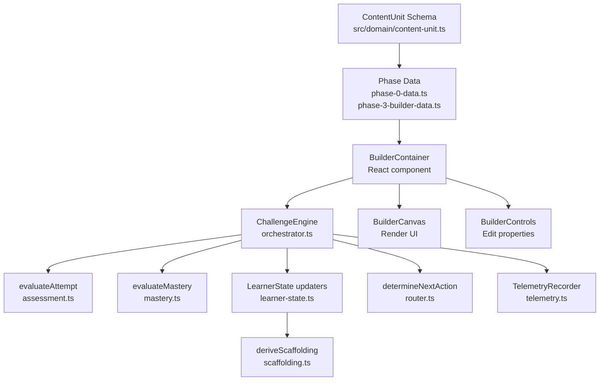

# APERTURE — Architecture

This document describes the architecture that exists in the codebase. Sections other than "Future Architecture" describe implemented behavior; "Future Architecture" is planned scope only. Verify against the source before relying on specifics, as this document can lag the code.

---

## System Overview

APERTURE is a client-side Next.js 14 application. There is no backend, database, or server-side persistence at this stage. The system is divided into three layers with strict one-directional dependency rules.

```
src/
├── domain/          Layer 1 — Content & Competency System (pure TypeScript, no React)
├── engine/          Layer 2 — Challenge Engine (pure TypeScript, no React)
└── app/             Layer 3 — Interaction / Runtime (Next.js App Router + React)
    components/
```

---

## Layer Responsibilities

### Layer 1: Domain (`src/domain/`)

The single source of truth for curriculum, competency, and exercise content. **No React imports. No UI logic.**

| File | Responsibility |
|------|---------------|
| `curriculum.ts` | Defines the 7 curriculum phases (`PHASE_0` through `PHASE_6`) and their guidance-level metadata. |
| `competency.ts` | Defines the 4 transformation tiers, 13 rung labels (0–12), 6 assessment competencies, 3 skill domains, and the prerequisite competency graph (`COMPETENCY_NODES`). |
| `content-unit.ts` | The `ContentUnitSchema` (Zod) — the contract between curriculum authors and the engine. Runtime-validates all `ContentUnit` objects. |
| `phase-0-data.ts` | Authored `ContentUnit` records for Phase 0 (First Contact / first 30 minutes). |
| `phase-3-builder-data.ts` | Authored `ContentUnit` records for Phase 3 (Interface Builder), plus all pure builder state functions and the `deriveCanvasAssessmentState` evaluator. |

**Content data gap:** Phases 1, 2, 4, 5, and 6 have no authored `ContentUnit` data yet.

### Layer 2: Challenge Engine (`src/engine/`)

A deterministic, pure-function infrastructure that processes learner attempts and manages state. **No React imports. No UI logic.**

| File | Responsibility |
|------|---------------|
| `assessment.ts` | `evaluateAttempt()` — compares attempt state against `ContentUnit.guidedPractice.targetState`, matches common mistake patterns, and produces a `FeedbackSequence`. |
| `learner-state.ts` | `LearnerState` type and all immutable state updaters (`recordAttempt`, `recordMistake`, `updateCompetency`, etc.). Rungs are cumulative and never degraded. |
| `mastery.ts` | `evaluateMastery()` — determines `MASTERED`, `TRANSFER_REQUIRED`, `PRACTICE_REQUIRED`, or `NOT_MASTERED` based on transfer requirements and competency graph state. |
| `scaffolding.ts` | `deriveScaffolding()` — rule-based computation of guidance level, hint count, and UI constraints from learner history. Escalates to HIGH on struggle; does not reduce support speculatively. |
| `router.ts` | `determineNextAction()` — deterministically routes to `PROCEED`, `RETRY`, `RECOVERY`, `TRANSFER`, or `STAY` using explicit `RoutingRules` thresholds. |
| `orchestrator.ts` | `ChallengeEngine` class — pure composition layer. Calls assessment → mastery → state update → routing → telemetry in a fixed, testable order. |
| `telemetry.ts` | `TelemetryRecorder` interface + `InMemoryTelemetryRecorder` implementation. Records 14 named event types. **Decoupled from persistence** — events are in-memory only with no backend connection. |

### Layer 3: Interaction / Runtime (`src/app/`, `src/components/`)

Next.js App Router pages and React components that consume Layer 1 and Layer 2. **May import from `domain/` and `engine/`. Must not be imported by those layers.**

| Path | Responsibility |
|------|---------------|
| `app/layout.tsx` | Root HTML shell, global CSS import, site-level metadata. |
| `app/globals.css` | Design system: CSS custom properties (color, spacing, motion tokens), base reset, `prefers-reduced-motion` support. |
| `app/page.tsx` | Home page — navigation to `/lab` and `/builder`. |
| `app/lab/page.tsx` | Lab route — renders the Phase 0 First Contact experience. |
| `app/builder/page.tsx` | Builder route — renders the Phase 3 Interface Builder. |
| `components/lab/` | `PhaseZeroContainer`, `ExerciseCanvas`, `ExplanationOverlay`, `exercises/` — Phase 0 interactive experience. |
| `components/builder/BuilderContainer.tsx` | Orchestrates Phase 3 state: loads units, wires engine, drives assessment + routing. Instantiates `ChallengeEngine` with `recoveryThreshold: 3, retryLimit: 5`. |
| `components/builder/BuilderCanvas.tsx` | Renders the interactive canvas grouped by container (`card_a`, `card_b`, standalone). Keyboard-navigable (`Enter`/`Space`, `ArrowUp`/`ArrowDown`). |
| `components/builder/BuilderControls.tsx` | Properties panel: element reorder (mouse + `Alt+Up`/`Alt+Down`), emphasis selector, grid spacing selector, container assignment. |

---

## Data Flow



**Dependency rule (convention):** Domain ← Engine ← UI, with no reverse imports. This is an architectural convention, not tooling-enforced: the repository has no lint rule, import-boundary checker or `tsconfig` setting that prevents violations. As of 2026-10-16 a search found no React or Next.js imports in `src/domain/` or `src/engine/`, and no imports from `src/engine/` in `src/domain/`. Reviewers must preserve this by hand.

---

## Key Contracts

### `ContentUnit` (Zod-validated at runtime)
The structured contract between content authors and the engine. Defined in `src/domain/content-unit.ts`. All Phase data files are validated against this schema by tests (`test/domain.test.ts`).

Fields include: `id`, `phaseId`, `competencyNodeIds`, `objective`, `prerequisites`, `initialExperience`, `explanation`, `guidedPractice`, `independentPractice`, `commonMistakes`, `hints`, `recoveryPath`, `assessmentCriteria`, `masteryCriteria`, `nextRecommendedUnitIds`.

### `LearnerState`
Immutable — every state update returns a new object. Structure:
```ts
{
  competencies: Record<string, CompetencyEvidence>,
  history: { recentAttempts, repeatedMistakes, hintUsageCount, retryCount },
  activeRecovery: { unitId: string | null }
}
```
`recentAttempts` is capped at 50 entries. Competency rungs never degrade (`Math.max` of existing and new rung).

### `FeedbackSequence`
Five-part authored feedback: `whatIDid`, `whatHappened`, `whyItHappened`, `principle`, `whatToTryNext`. Generated from domain content, not free-form AI text.

### `RoutingRules`
Configurable thresholds passed to `ChallengeEngine` at construction time:
- `recoveryThreshold`: number of repeated identical mistakes before recovery is triggered (required; `BuilderContainer` uses 3)
- `retryLimit`: total retry count before recovery is triggered (required; `BuilderContainer` uses 5)

---

## State Management Rules

1. `LearnerState` is React state in `BuilderContainer`. Engine receives it as a pure input and returns a new state — the component stores it.
2. `BuilderCanvasState` (element list + selection) is separate React state in `BuilderContainer`. It is never mutated in place.
3. `ChallengeEngine` is stateless except for its `TelemetryRecorder`. The telemetry recorder is in-memory per page load (no persistence).
4. No external state management library is used or permitted at this stage.

---

## Testing Boundaries

Tests live in `test/` and are run with `tsx --test` (Node.js native test runner). No test framework library.

| Test file | What it covers |
|-----------|---------------|
| `test/domain.test.ts` | Curriculum phase definitions, competency rungs, `ContentUnit` schema runtime validation |
| `test/engine/assessment.test.ts` | `evaluateAttempt` success, mistake matching, fallback feedback |
| `test/engine/learner-state.test.ts` | All 7 immutable state updaters |
| `test/engine/mastery.test.ts` | `evaluateMastery` paths |
| `test/engine/orchestrator.test.ts` | `ChallengeEngine.processAttempt` end-to-end |
| `test/engine/router.test.ts` | `determineNextAction` all routing outcomes |
| `test/engine/scaffolding.test.ts` | `deriveScaffolding` level escalation rules |
| `test/engine/telemetry.test.ts` | `InMemoryTelemetryRecorder` — event recording and copy safety |
| `test/builder/builder-logic.test.ts` | Pure builder state functions + `deriveCanvasAssessmentState` |
| `test/builder/builder-engine.test.ts` | Phase 3 end-to-end: Builder ↔ ChallengeEngine integration |

React components (Layer 3) are not unit-tested. Acceptance criteria for those layers are covered through integration and usability testing (planned in Stage 8).

---

## Current Limitations

| Area | Limitation |
|------|-----------|
| **Persistence** | No backend, database, or session storage. All learner state is lost on page reload. |
| **Content coverage** | `ContentUnit` data exists only for Phase 0 and Phase 3. Phases 1, 2, 4, 5, 6 have no authored content. |
| **Lab ↔ Builder continuity** | The `/lab` (Phase 0) and `/builder` (Phase 3) routes share no learner session. No cross-route progress tracking. |
| **Telemetry** | Events are recorded in-memory only. There is no backend event sink, analytics pipeline, or log persistence. |
| **Authentication** | None. No user accounts, sessions, or identity. |
| **Adaptive assessment** | Deferred (Stage 6 Tier B; Tier A rule-based MVP is unblocked but not started). Current engine is deterministic rule-based, not adaptive. |

---

## Security Principles

The following principles apply to APERTURE now and into all future stages.

### Existing controls (verified in current codebase)

| Principle | Current Status |
|-----------|---------------|
| **Secrets must never be committed** | `.gitignore` excludes `.env`, `.env*.local`, `.env.development.local`, `.env.test.local`, `.env.production.local`. A point-in-time check on 2026-10-16 (pattern search of `src/`, `test/` and config files; tracked-file list) found no secrets and no tracked `.env` or key files. This is not a continuous scan. |
| **Input validation at boundaries** | All `ContentUnit` data is runtime-validated via Zod schema (`ContentUnitSchema`) at the domain boundary. Builder element operations are bounds-checked (index range, valid `GridSpacing` values, valid `ElementEmphasis` values). |
| **No sensitive data stored** | There is no backend, no database, and no user data collection. `LearnerState` exists only in React component memory. |
| **Errors do not expose secrets** | As of 2026-10-16 `src/` contains no `console.*` calls, browser storage use or network calls. Error output is standard TypeScript/Next.js. |
| **`prefers-reduced-motion` respected** | CSS in `globals.css` suppresses animations for users who have enabled the accessibility setting. |

### Missing controls (required before production)

| Principle | Current Gap | Required When |
|-----------|-------------|---------------|
| **Server-side authorization** | None — no server or protected routes exist yet. | Required when any protected user data or operations are introduced. Client-side checks must never substitute for server-side authorization. |
| **Authentication / session management** | None — no user accounts. | Required before storing personal learner data. Must use an established, maintained solution (e.g., NextAuth.js, Clerk) — do not implement a custom session system. |
| **Learner data minimization and protection** | No personal data is collected today. | Required when learner profiles, progress records, or any PII is introduced. Apply data minimization; protect at rest and in transit. |
| **HTTP security headers** | Not configured — Next.js defaults only. | Required before public deployment. At minimum: `Content-Security-Policy`, `X-Frame-Options`, `X-Content-Type-Options`, `Referrer-Policy`. |
| **Dependency vulnerability scanning** | No automated scanning configured. | Should be established before any public release. Use `npm audit` or an automated tool. |
| **Abuse prevention** | No rate limiting or bot protection. | Required before any form submission, authentication, or account creation is added. |
| **Backup and recovery** | Not applicable (no data to back up today). | Required when user data persistence is introduced. |
| **Monitoring and alerting** | Not applicable (no production deployment). | Required before public launch. |

> [!IMPORTANT]
> **Security requirements must be tested and verified, not merely documented.** Do not claim APERTURE is secure or production-ready based on this document alone.

---

## Future Architecture (Planned, Not Yet Built)

The following is planned scope derived from the Master Product Blueprint. None of it is implemented.

- **Backend persistence layer:** User accounts, learner state persistence, progress records. Needed for cross-session adaptation and for Stage 6 Tier B; not needed for the Tier A rule-based MVP, which can operate on in-memory `LearnerState`.
- **Adaptive routing:** Stage 6 Tier A (deterministic rule-based drills) is unblocked but not started; Tier B (learned or generated adaptation, requiring real usage data) is deferred — see ROADMAP
- **Remaining curriculum phases:** Content units for Phases 1, 2, 4, 5, 6
- **End-to-end capstone flow:** Cross-phase learner journey, portfolio generation (Stage 7)
- **Telemetry backend:** Event pipeline for real analytics (required before Stage 6 Tier B)
